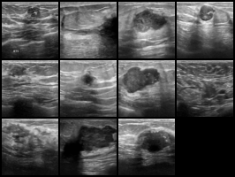
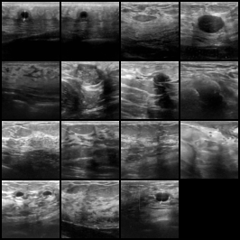

# Locked-Checkpoint Error Analysis

This run reloads a saved checkpoint. Weights are not updated, and no new clinical threshold is selected. False negatives are missed malignancies at the default 0.5 cutoff.

- Checkpoint: `runs/breastmnist_baseline_seed7/model.pt`
- Split: `test` (156 images)
- True positives: 31
- True negatives: 99
- False positives: 15
- False negatives: 11

## Missed malignancies

| Index | Malignant probability |
|---:|---:|
| 48 | 0.041 |
| 141 | 0.056 |
| 44 | 0.074 |
| 85 | 0.117 |
| 68 | 0.119 |
| 104 | 0.166 |
| 135 | 0.175 |
| 40 | 0.192 |
| 7 | 0.305 |
| 24 | 0.353 |
| 95 | 0.426 |

## False alarms

| Index | Malignant probability |
|---:|---:|
| 76 | 0.957 |
| 143 | 0.902 |
| 82 | 0.889 |
| 63 | 0.857 |
| 19 | 0.847 |
| 149 | 0.828 |
| 91 | 0.796 |
| 25 | 0.762 |
| 86 | 0.759 |
| 73 | 0.737 |
| 56 | 0.594 |
| 131 | 0.589 |
| 113 | 0.544 |
| 151 | 0.523 |
| 89 | 0.501 |

## Conflicting split-overlap cases on this split

| Split index | Published remapped label | Model probability | Outcome |
|---:|---:|---:|---|
| 76 | 0 | 0.957 | false_positive |

## Temperature scaling (fit on validation only)

- Fitted temperature: 1.000
- Fit split: `val`
- Unscaled Brier / ECE: 0.123 / 0.084
- Scaled Brier / ECE: 0.123 / 0.084

Temperature was fit on the validation split only. It rescales probabilities for a calibration diagnostic and is not a new model, threshold, or clinical operating point.

These galleries and scores are for research review of a public 64px benchmark. They are not a clinical case review.
